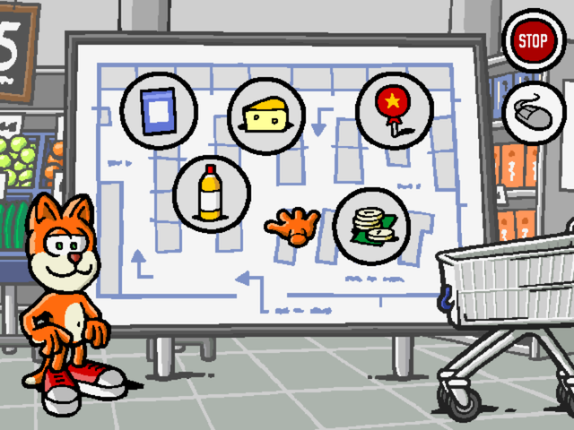
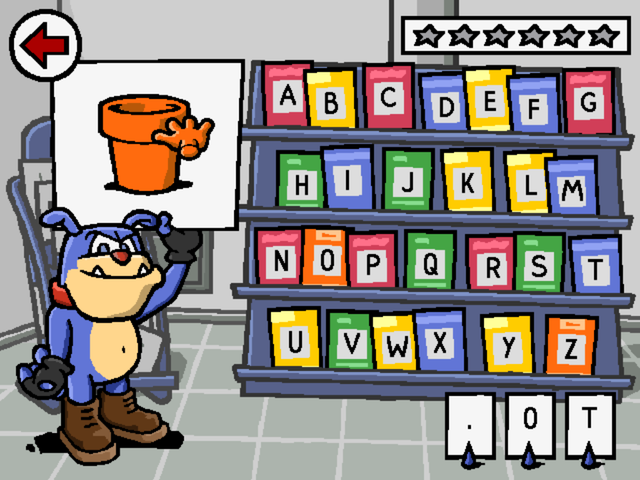

# Redcat Kleuter 1: In de supermarkt — port

Play **Redcat Kleuter 1: In de supermarkt**, the Dutch CD-ROM game for children aged 3 to 6 from
2000, on today's devices.

  
  

The game was made with Macromedia Director 6. Its scripts were decompiled and rebuilt one by one,
so the port plays like the original: the same pictures, speech, music, timing and rules.

This repository contains only the **port**. It contains **none of the game's files** (pictures,
sounds, music, speech, the logo film). To play, you need **your own copy of the Redcat Kleuter 1
CD**. Copying the CD to a folder is fine too.

## Versions

| Version | Folder | Runs on |
|---------|--------|---------|
| Web | [`web/`](web/) | Chrome, Edge, Firefox and Safari on a computer, an iPad or another tablet. [How to play](web/README.md) |

Each version has its own folder with its own instructions.

## Legal

Redcat Kleuter 1, its name, characters, pictures, sounds, speech, music and film are the property
of their rights holders. This repository contains none of them; you need your own copy of the
game to play.

Third-party code and its licenses are listed in each version's `THIRD-PARTY-LICENSES.txt`.
